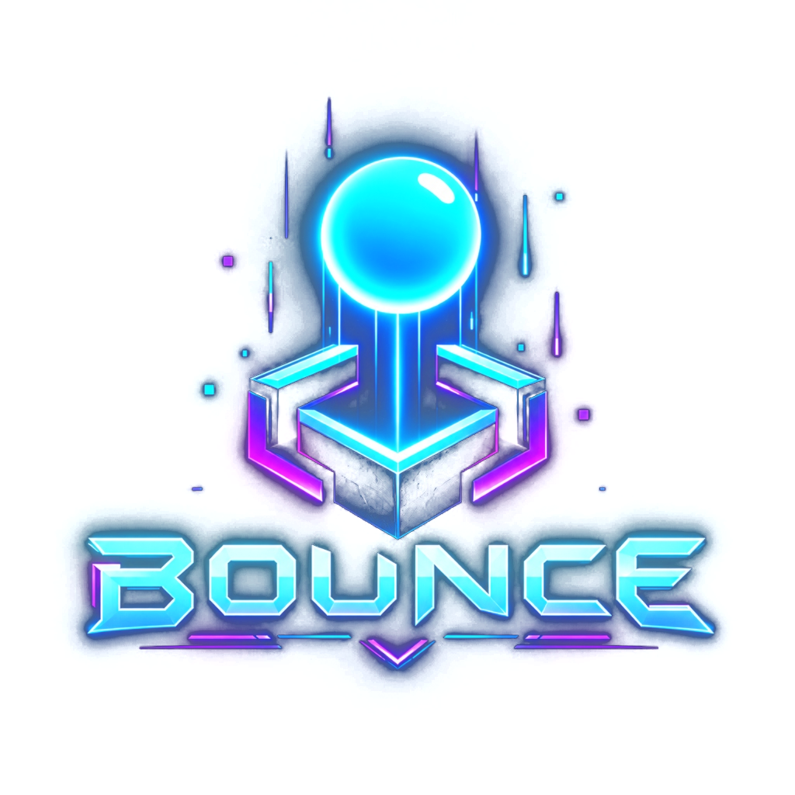
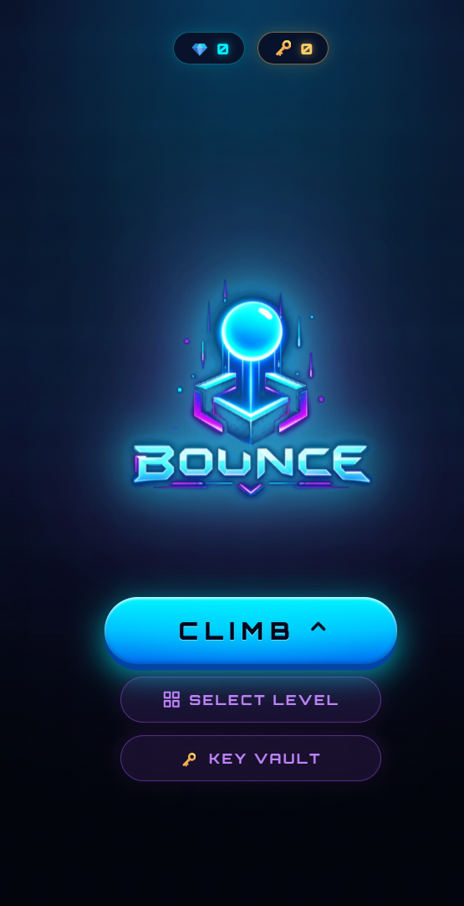
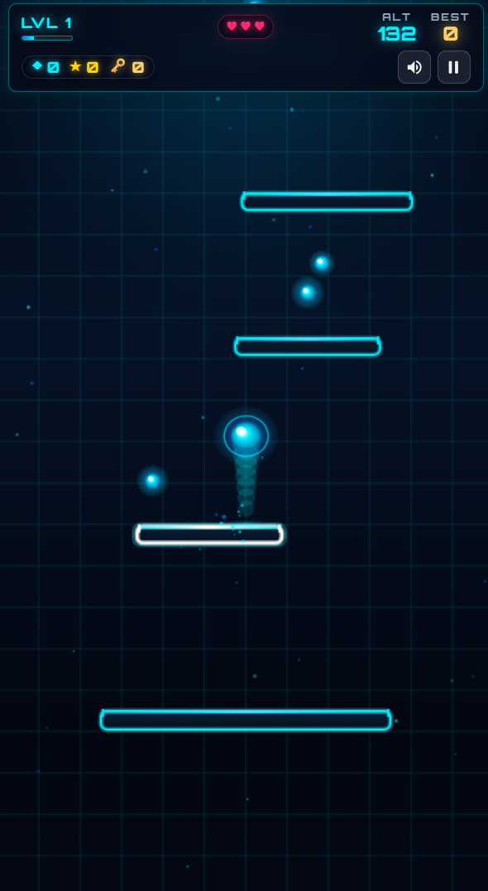
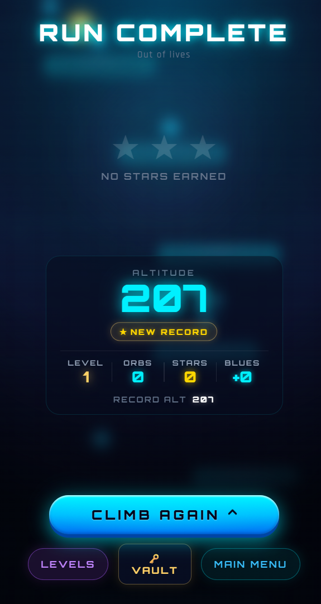

# BOUNCE

### Endless Neon Vertical Arcade Climber

BOUNCE is a mobile arcade game where players bounce between platforms, avoid hazards, collect rewards, and climb through progressively challenging neon environments.

---

## Download

[**Download BOUNCE APK**](https://github.com/Jay-81/bounce/releases/latest)

---

## Screenshots

|                          Home Screen                           |                            Gameplay                             |                            Results                            |
| :------------------------------------------------------------: | :-------------------------------------------------------------: | :-----------------------------------------------------------: |
|  |  |  |

---

## Game Features

- **Endless Vertical Climbing** — Bounce upward across continuously ascending platforms, timing jumps and dives to survive procedural heights.
- **Neon Themes and Visual Transitions** — Atmospheric neon palettes that smoothly interpolate background, platform, and ambient lighting as altitude increases.
- **Multiple Worlds and Level Progression** — Progressive milestone levels organized into distinct worlds, with dimensional portals unlocking higher worlds upon completion.
- **Lives and Respawn System** — A three-life safeguard that preserves current altitude, respawning the player on the last safe platform with a temporary countdown.
- **Collectibles and In-Game Currency** — Blue Orbs and Golden Stars scattered along the climb that reward Blues currency to build player balances.
- **Key-Based Continue System** — Exchange collected Blues for Keys in the Key Vault to revive expired runs without resetting progress.
- **Star Ratings and Rewards** — Performance ratings earned across level milestones based on climb efficiency, preserved alongside personal best records.
- **Offline Progress Saving** — Player milestones, currency, star ratings, and high scores persist locally on the device with zero network connection required.

---

## Mobile Controls

| Control   | Action               |
| :-------- | :------------------- |
| **LEFT**  | Move left.           |
| **DIVE**  | Accelerate downward. |
| **JUMP**  | Perform an air jump. |
| **RIGHT** | Move right.          |

---

## Technology Stack

- HTML5
- CSS3
- JavaScript
- HTML5 Canvas
- Capacitor 8
- Android

---

## Developer

Jayani K

---

## License

All rights reserved.
