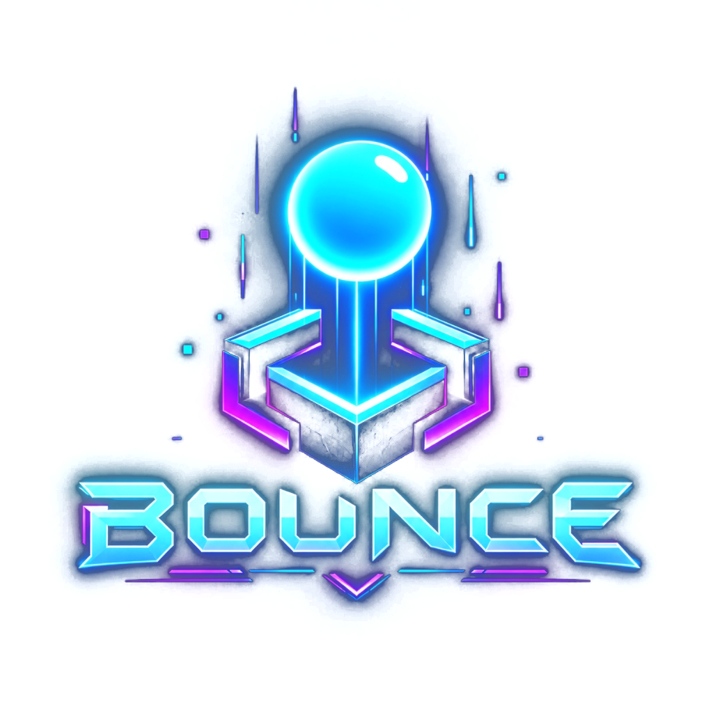
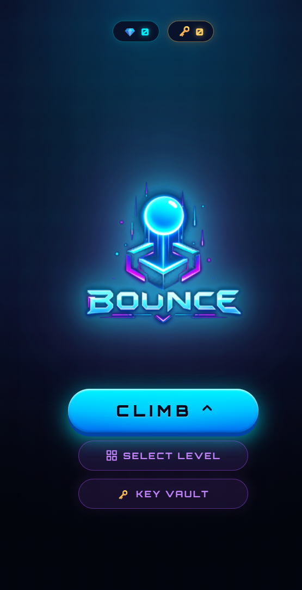
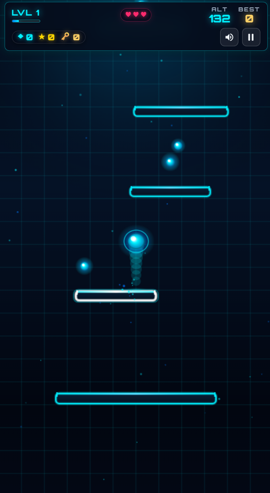
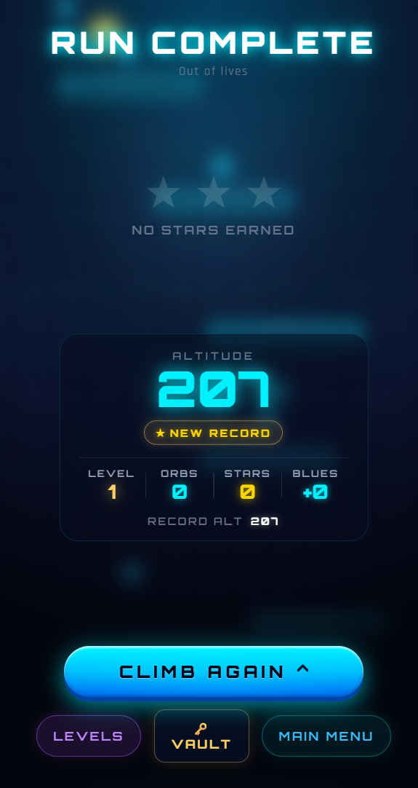

# BOUNCE

### ENDLESS NEON CLIMB ARCADE

**Jump higher. Dodge hazards. Conquer neon worlds.**

_An endless climb through a world of neon, challenges, and rewards._

---

## 🎮 About BOUNCE

BOUNCE is a fast-paced vertical-climbing arcade game where every jump takes you higher.

Control your neon ball, navigate challenging platforms, dodge dangerous obstacles, and explore vibrant worlds. Collect rewards, unlock new levels, and push your climbing record further.

## 📸 Game Preview

  
  
  

## ✨ Features

|     | Feature               | Description                                               |
| :-: | --------------------- | --------------------------------------------------------- |
| ♾️  | **Endless Climbing**  | Keep ascending through progressively challenging levels.  |
| 🌈  | **16 Neon Themes**    | Discover vibrant visual themes as you advance.            |
| 🌍  | **Multiple Worlds**   | Unlock new worlds through level milestones.               |
| ❤️  | **Three-Life System** | Get three lives and respawn from your last safe platform. |
| 💎  | **Collectibles**      | Gather Blue Orbs and Stars to earn Blues.                 |
| 🔑  | **Key Vault**         | Exchange collected Blues for keys.                        |
| 🚀  | **Continue System**   | Use keys to restore your lives and continue your run.     |
| 📱  | **Mobile Controls**   | Touch-friendly controls designed for mobile gameplay.     |
| 🔊  | **Arcade Audio**      | Enjoy procedurally generated sound effects.               |

## 🕹️ How to Play

Keep bouncing, avoid hazards, and climb as high as possible.

**Controls**

| Action     | Keyboard    | Mobile       |
| ---------- | ----------- | ------------ |
| Move Left  | `A` / `←`   | LEFT         |
| Move Right | `D` / `→`   | RIGHT        |
| Jump       | `W` / `↑`   | JUMP         |
| Dive       | `S` / `↓`   | DIVE         |
| Sound      | `M`         | Sound Button |
| Pause      | `Esc` / `P` | Pause Button |

### 💎 Collect & Earn

| Collectible |    Reward |
| ----------- | --------: |
| Blue Orb    |  +5 Blues |
| Golden Star | +25 Blues |

### 🌍 Explore New Worlds

- Each world contains 12 levels.
- Reach Level 12 to unlock the next world.
- Continue progressing through new worlds and challenges.

### ❤️ Keep Climbing

- Start each run with three lives.
- Falling or hitting hazards costs one life.
- Respawn at your last safe platform.
- Use a key when all lives are exhausted to continue your run.

## 🛠️ Built With

| Technology        | Purpose                       |
| ----------------- | ----------------------------- |
| **HTML5**         | Game structure                |
| **CSS3**          | Interface and visual design   |
| **JavaScript**    | Game mechanics and physics    |
| **HTML5 Canvas**  | Game rendering                |
| **Web Audio API** | Sound effects                 |
| **Capacitor 8**   | Android application packaging |

## 🚀 Coming Soon

BOUNCE is being prepared for its Android release on the **Google Play Store**.

Stay tuned for the launch!

## 👨‍💻 Developer

**Jayani K**

[GitHub Profile](https://github.com/Jay-81) · [BOUNCE Repository](https://github.com/Jay-81/bounce)

---

### KEEP BOUNCING. KEEP CLIMBING.

**BOUNCE** 🎮

